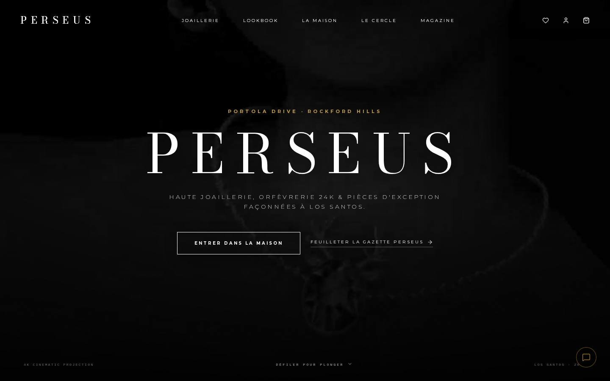
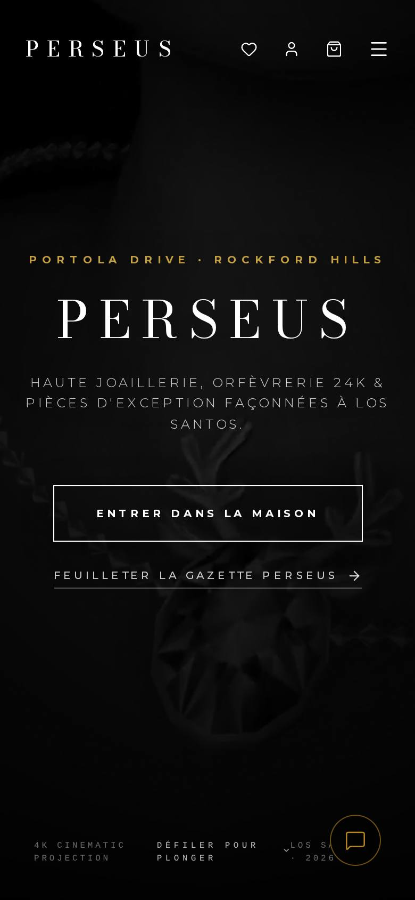

# Perseus — Roleplay Jewelry House for GTA World

Online store and brand site for **Perseus**, a high-end jewelry house that exists inside the GTA World roleplay server (Portola Drive, Rockford Hills). Players sign in with their **GTA World UCP account**, pick their in-game character, and pay with in-game money through **Fleeca Bank**. Orders are handled by staff from Discord.



## Features

- **GTA World OAuth login** (`ucp-fr.gta.world`) with in-game character selection
- **In-game payments** through the Fleeca Bank API, with a payment callback that confirms the order
- **Store**: catalog, product pages, cart, checkout, loyalty points and wishlist
- **Discord bridge**: new orders are posted to a staff channel and approved from Discord
- **Admin area**: products, orders, store configuration, daily and abandoned-cart stats
- **Brand content**: lookbook, seasonal collections, gallery, in-universe magazine
- **In-game phone app** view (`/mobile`) designed for FiveM

<p>
  
</p>

## Stack

- Next.js (App Router), React, TypeScript, Tailwind CSS, Framer Motion
- libSQL / Turso database
- discord.js for the order bridge and the staff bot
- JWT sessions, bcrypt password hashing

## Project structure

```
app/          pages and API routes (auth, orders, payment, admin, loyalty)
components/   UI components, including the in-game phone app
lib/          auth, database access, catalog
scripts/      Discord bridge, staff bot, database init and migrations
```

## Running locally

```bash
npm install
cp .env.example .env   # then fill in the values
node scripts/init-db.mjs
npm run dev
```

Product photos, lookbook images and videos are not included in this repository to keep it light.

## Security notes

All credentials (GTA World OAuth secret, Fleeca API key, Discord tokens, JWT secret) are read from environment variables and never committed. See `.env.example` for the full list.
